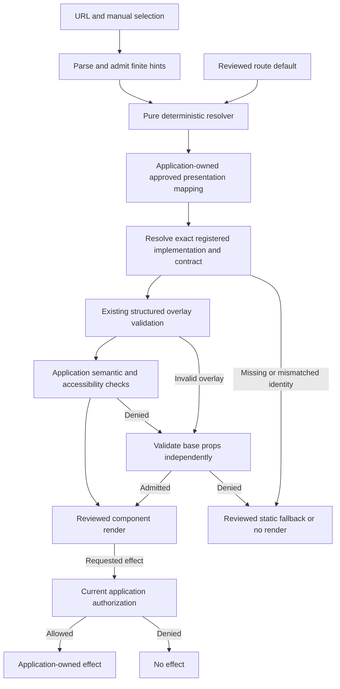

# Governed audience-resolved personalization demo

Status: **Proposed implementation contract**. This document defines the deterministic baseline for [#131](https://github.com/hackelia-micrantha/amaryllis/issues/131), part of [#125](https://github.com/hackelia-micrantha/amaryllis/issues/125). It is not a claim that this demo, a model-based resolver, or mobile performance has been implemented or verified. The [predictive intelligence RFC](../predictive-intelligence-rfc.md) and #170 build upon this baseline; #171 remains conditional research. Existing correctness and release hardening (#88) retain priority.

## Goal

Show how the same reviewed developer-portal component tree adapts its presentation to an explicit audience preference without generating executable UI, inferring identity, requiring a model, or changing application authority. The initial demo is application-owned, local and deterministic; a subsequent implementation should reuse existing registered component and personalization contracts.

| Audience ID | Intended presentation | First evidence |
| --- | --- | --- |
| developer | API-oriented explanation and integration CTA | API example and architecture |
| security_reviewer | Trust boundaries and limitations first | Security and threat model |
| hiring_manager | Concise project impact and engineering approach | Implemented capabilities and evidence |
| open_source_contributor | Contribution and verification workflow | Contribution documentation |
| founder_customer | Use cases and product outcomes, no unsupported claims | Use cases and limitations |
| unknown | Neutral overview with all navigation available | Project documentation |

These are **presentation preferences**, not verified identities, authenticated roles, entitlements, or security classifications.

## Resolution contract

Use a finite, case-sensitive allowlist containing exactly the six IDs above. The literal `unknown` is a valid explicit neutral preference; it stops precedence resolution when selected. It differs from an absent or invalid hint. The demo route has a reviewed static default (initially unknown).

Precedence: **valid explicit query parameter > valid manual selection > reviewed route default > unknown**. Read only the designated audience parameter and accept exactly one occurrence whose decoded value matches the allowlist. Missing, empty, repeated or invalid values are ignored as hints, not normalized into privileged or meaningful identifiers; never echo raw invalid text. Query and manual selection are independent inputs. Manual selection is transient demo-local state and never rewrites the URL. When an admitted query is present, show its winning preference, disable the manual selector with an accessible explanation, and provide a separate "Clear URL preference" navigation action. That action removes all audience parameter occurrences, preserves unrelated route data, and clears manual state on the committed navigation; it is not a manual audience selection. After the query is cleared, the user may select an audience manually. Reset manual selection clears only manual state. An invalid query does not lock the selector. Back/forward or other committed route navigation resets manual state and resolves the new URL and route default; manual-only preferences are not browser-history entries. Resolve from the current committed inputs and do not apply a pending navigation result to a newer route. Without an applicable route default, use unknown.

The initial resolver has no clock, storage, network, model or UI-framework dependency. It consumes only a bounded parsed query hint, the manual selection and the configured route default. It returns the inspectable result shape proposed by #131: audience, confidence, admitted hints and resolution provenance, with a finite reason code. Hints contain only allowlisted values and sources in precedence order (including valid losing hints), never raw rejected values. ResolvedBy contains exactly the winning source, or is empty for the no-hint neutral fallback. Confidence is deterministic metadata: 1 when a non-neutral audience is selected by an admitted rule, 0 for a neutral result (including an explicit unknown). It is not an estimated probability of identity or a model score, and it never changes precedence or grants authority. The reason and resolvedBy distinguish an explicit neutral choice from fallback. Invalid input is not a confidence signal. Any future probabilistic hint requires its own reviewed score semantics under #170.

Illustrative result (demo-local, not a new public package API):

```ts
type Audience = 'developer' | 'security_reviewer' | 'hiring_manager'
  | 'open_source_contributor' | 'founder_customer' | 'unknown';

type AudienceSource = 'query' | 'manual' | 'route';

type AudienceHint = Readonly<{
  audience: Audience;
  source: AudienceSource;
}>;

type AudienceResolution = Readonly<{
  audience: Audience;
  confidence: 0 | 1;
  hints: readonly AudienceHint[];
  resolvedBy: readonly AudienceSource[];
  reason: 'explicit-query' | 'explicit-manual' | 'route-default' | 'neutral-default';
}>;
```

Explicit accessibility preferences are independent constraints, not audience hints. Personalization must not override them.

## Rendering and trust boundaries



The fallback base props must independently satisfy the same applicable semantic and accessibility constraints; if they cannot, use a separately authorized static presentation or render nothing. Registry identity mismatch never triggers implicit latest-version lookup or registration. Rendering never grants permission to invoke a capability. Current package validation is not automatic full application policy enforcement; use the existing [runtime personalization](../runtime-personalization.md) boundary and compose explicit application checks.

| Component responsibility | Allowed variation | Invariant |
| --- | --- | --- |
| Audience switcher | Selected preference, clear URL override and reset | Same accessible control and explanation for all audiences |
| Hero | Reviewed headline, summary, CTA order | Approved destinations and claims only |
| Capability grid | Ordering and copy density | Same capabilities, no fabricated support |
| Evidence panel | Which reviewed evidence is surfaced first | All evidence reachable; no audience-only secret data |
| Resolved spec viewer | Normalized audience, admitted hints, winning source, reason, deterministic confidence, selected variant IDs and registered identity | No raw URL values, personal data, credentials or prompts |
| Trust boundary panel | Explanatory emphasis | Invariants, limitations and security guidance never hidden |

Use finite application-owned presentation tables and fixed registered IDs/versions. Review copy, ordering and links as ordinary source. Model output is not involved. Preserve the same navigation destinations, accessibility semantics, capability set and authorization rules across all variants. No dynamic imports, arbitrary JSX, URL or executable content, policy/spec mutation, registry replacement, pricing, eligibility or access decisions.

## Scope and privacy

No authentication, visitor classification, referrer/campaign inference, behavioral tracking, analytics, persistent profile, network inference, or cross-session storage. Explicit audience hints are public display choices and must not be treated as secrets or identity evidence. Do not retain raw query values in demo diagnostics; underlying hosting/navigation logging is a separate concern and must not be represented as controlled by this resolver. Keep the example usable with no model artifact. No new package, runtime, framework or mandatory CI workflow.

Future #170 experiments may add an optional injected predictor using admitted synthetic features and independently validated hints. They must preserve explicit selection and accessibility precedence, exact registry identity and current authorization. The deterministic demo must remain a usable fallback and fair comparator. No real visitor telemetry or online learning is authorized by this contract.

## Verification plan (not yet executed)

Use real pure resolver and existing registry/contract implementations in tests, with controlled adapters only at actual effect boundaries. Verify rendered behavior in the existing example surface where the component contract is exercised; a mocked registry or fixture-only assertion does not prove mediation.

| Given | When | Then |
| --- | --- | --- |
| Valid query and conflicting manual selection | Resolve current route | Query wins, winning source and reason visible |
| Missing or malformed/repeated query | Valid manual selection exists | Manual wins; raw query not exposed |
| No valid explicit choice | Reviewed route default exists | Route default wins |
| No admitted hint/default | Resolve | Neutral presentation |
| Explicit unknown choice | Other default exists | Explicit neutral preference wins; confidence 0, explicit source retained |
| No admitted hint and no route default | Resolve | Neutral fallback, confidence 0, empty resolvedBy |
| Valid query in current URL | User opens manual selector | Query remains authoritative; manual selection disabled with accessible explanation |
| Valid query in current URL | User clears URL preference | Audience parameters removed, unrelated route data preserved, manual state cleared on commit |
| No admitted query | User chooses or resets manual preference | Manual choice wins or falls back to route default; URL unchanged |
| Browser history changes | Route commits | Manual state reset; current URL and route default determine presentation |
| Valid conflicting hints | Inspect resolved spec | Only admitted hints, winning source, deterministic confidence and finite reason exposed |
| All six audiences | Render | Allowed variant only, exact identity, shared navigation and accessibility; evidence remains reachable |
| Invalid variant or overlay | Validate | Authorized base presentation or safe non-render |
| Missing/mismatched registry identity | Resolve | No implicit latest, replacement or unsafe render |
| Valid schema but forbidden semantics | Apply | Denied independently of schema validity |
| A valid displayed CTA | User requests an action | Application policy checks actual current authority |
| No model or network inference route | Resolve and render | Same deterministic presentation |
| Unknown/malicious query content | Inspect resolved spec | Only admitted finite IDs and reviewed metadata appear |

Implementation should first establish pure resolver and presentation fixtures, then wire the smallest existing example route and exercise actual rendering/validation. Use the current repository test/package validation commands; no additional CI infrastructure. Record exact candidate, test outcomes and limitations. Do not claim hardware or user-utility evidence from synthetic fixtures. #131's documentation acceptance can be reviewed independently of implementation; the demo baseline in #170 remains incomplete until implemented and verified.

## References

- [AI-enabled components](../ai-enabled-components.md)
- [Runtime personalization](../runtime-personalization.md)
- [Security model](../security-model.md)
- [Predictive intelligence RFC](../predictive-intelligence-rfc.md)
