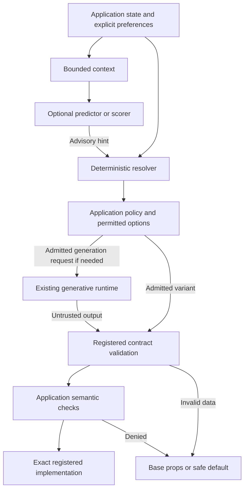

# RFC: Governed predictive and decision intelligence

Status: **Proposed / experimental**. This is a research architecture, not a description of shipped capabilities, an accepted API, a runtime migration, or a commitment to implement every candidate.

Tracking: [#170 — prediction and decision models](https://github.com/hackelia-micrantha/amaryllis/issues/170), [#171 — world models and planning](https://github.com/hackelia-micrantha/amaryllis/issues/171). Existing component roadmap [#125](https://github.com/hackelia-micrantha/amaryllis/issues/125) and deterministic personalization demo [#131](https://github.com/hackelia-micrantha/amaryllis/issues/131) remain authoritative for their scope. Correctness and release hardening (#88) retain priority.

## Motivation

Amaryllis currently combines an on-device generative runtime, a context engine, and governed component tooling. Many interactive decisions do not require language generation. An inexpensive classifier, ranking function or deterministic rule may choose an appropriate presentation or avoid an unnecessary LLM request. A predictive state model may eventually help with multi-step workflows.

The objective is user task utility under device, privacy and security constraints, not engagement maximization or autonomous execution. Local execution is desirable but is not proof of safety, accuracy or compatibility.

## Responsibilities and ownership

| Capability | Responsibility | Authority |
| --- | --- | --- |
| Context Engine | Bounded retrieval, optional scoring, application-owned context | No policy or identity authority |
| Prediction | Estimate an outcome, next state, intent or likelihood | Advisory only |
| Decision | Rank or recommend from application-defined options | Advisory only |
| Generation | Produce text or bounded structured component data | Existing untrusted-output path |
| Application resolver and policy | Resolve explicit preferences, admit options, enforce semantics and authorize effects | Application-owned |
| ComponentSpec, registry and runtime validation | Define permitted data and exact registered implementation | Existing component authority |
| Verify | Record test and device evidence | Evidence, not permission |

Do not conflate a decision model with an authorization mechanism, an embedding with a future prediction, or a latent predictor with a planner. These are conceptual roles rather than new packages or mandatory interfaces.

## Proposed data flow

Policy must precede sensitive input disclosure and inference invocation as well as any downstream application effect. The diagram shows the logical data path, not an automatic complete-policy implementation in today's runtime. Current programmatic personalization validates the registered JSON contract, unsafe keys and patch bounds; full package PolicyEngine mediation is not implicit. Applications must compose semantic, capability, accessibility and network policy independently. See [runtime personalization](runtime-personalization.md) and [security model](security-model.md).

An optional predictor cannot register components, choose arbitrary implementation versions, change specs or introduce executable source. Recommendations for navigation or actions are distinct from performing them; actual effects require current application authorization. On policy denial use a safe non-effect state, not another model or a less restrictive route.

## Initial experiment: adaptive components

Extend the #131 demo after its deterministic contract is accepted. Preserve the existing explicit query/manual selection precedence and unknown/default semantics. The experiment may suggest approved presentation variants using synthetic non-sensitive context when explicit preference is absent; it may not infer identity or authenticated role. Explicit selections and accessibility preferences always win. Components consume the resolver result rather than scraping context themselves.

Compare the deterministic baseline with a small linear classifier or decision tree. If the baseline is adequate, stop. Only consider a contextual bandit if there is a demonstrated choice problem, suitable outcome data, and an ethically acceptable evaluation design. Offline logged-bandit evaluation requires known action support and propensities or an otherwise justified estimator; observational logs alone cannot establish counterfactual utility. No production exploration or persistent online learning is implied.

Candidate response semantics (illustrative, not a new exported API): a finite allowed variant identifier, a model/artifact identity, a score whose semantics are specified per model, and a request/context revision. Absence of a result is abstention. Reject nonfinite/out-of-range scores where a range is defined, unknown options, malformed data, mismatched identity, expired context and results delivered after cancellation or a changed preference. Recheck admissibility at use time. Do not call arbitrary scores calibrated probabilities.

## Predictive inference routing

Use a separately measured synthetic workload to compare application rules against a lightweight classifier that recommends whether generation is useful. False negatives may degrade task quality; false positives waste device resources. Establish the quality regression budget and resource benefit before choosing a candidate. Route selection cannot change data permissions, select a remote fallback implicitly, bypass the existing single-flight lifecycle or alter model asset admission. Honor cancellation and resource limits; no automatic retries on denial.

## Predictive state models and JEPA

For a bounded workflow define observable state, valid actions, transition horizon and success measure. Establish Markov/transition-table and small supervised sequence comparators. An action-conditioned latent predictor may be considered only if these fail a meaningful sequential-prediction requirement. A planner could score a bounded set of candidate sequences against an explicit objective; the model does not execute them.

JEPA-style models predict representations rather than necessarily reconstructing raw inputs. V-JEPA 2 is a physical-world research reference, not a drop-in UI predictor or a mobile compatibility claim. Application interaction training, action semantics, uncertainty estimation and evaluation remain separate research questions. Compare multi-step compounding error, distribution shift, task utility and cost with the simpler models.

## Runtime evolution

Begin in TypeScript using the existing example/test surface and no new native dependency. Keep the existing MediaPipe LLM API and compatibility contract unchanged. If a trained neural candidate demonstrates material value, perform a separate runtime comparison (e.g. general-purpose LiteRT, supported platform inference, and the existing generative path). Assess actual operator coverage, model conversion, acceleration/fallback, packaging, licensing, artifact identity, lifecycle, cancellation and peak memory on both supported platforms. A general ML runtime and a generative runtime may have different requirements; do not assume interchangeable model formats or universal compatibility.

Applications own model assets, trust policy, distribution and device resource budgets. Pin executable model bytes and configuration, validate integrity before use, prevent unauthorized updates/implicit downloads, and fail safely if a required artifact or backend is unavailable. Do not add training, model distribution or hosting infrastructure as part of this RFC.

## Threats and controls

| Threat or failure | Proposed control / required evidence |
| --- | --- |
| Malicious or stale recommendation | Independent option admission, revision binding, cancellation and effect-time checks |
| Policy bypass through validated props | Application semantic checks and explicit capability constraints; negative tests |
| Model tampering or unsafe asset | Explicit provisioning, reviewed artifact digest/licensing and bounded loader inputs |
| Sensitive inference and feedback retention | Minimize feature set, no real visitor profiling in first experiment, local opt-in feedback only in later approved work, no raw context in evidence |
| Resource exhaustion or background lifecycle race | Bounded request size/time, cancellation, existing lifecycle contract, static fallback |
| Overconfidence, drift or harmful adaptation | Abstention, held-out evaluation, explicit user override, accessibility invariants and stop criteria |
| Client compromise | Never treat client predictions or preferences as server-side entitlement or authorization proof |

No pricing, eligibility, access-control decisions, sensitive identity inference, unrestricted runtime code generation, hidden network fallback, or production adaptive learning. Proposed changes to trust/data flow require review under #96 and applicable security requirements before implementation.

## Evidence and progression

Predeclare task success and meaningful improvement over a deterministic baseline, allowable regression, uncertainty reporting and resource budgets. Record exact application/model/configuration identities, data splits, seeds, environment and evaluation protocol. Use independent expected outcomes; prevent train/test leakage. Measure task quality, calibration or appropriate score semantics, abstention, invalid/denied outputs, fallback, latency and memory. Measure energy or thermals only with defensible collectors.

- Synthetic tests establish contract and policy behavior, not real user utility.
- Device qualification under #117 establishes supported hardware/runtime observations, not broad compatibility. Simulators are not physical evidence.
- Real-world effectiveness requires a separate ethically designed and approved study; no visitor analytics in the current demo.

Stages: deterministic baseline; lightweight decision comparator; conditional bandit and predictive routing; conditional state/world-model research; conditional device qualification and API review. For each, record adopt/defer/reject with evidence and maintenance trade-offs. Stop when a simpler solution is sufficient. No new mandatory CI, package, native runtime or stable API until independently justified and reviewed.

## References

- [Li et al., A Contextual-Bandit Approach to Personalized News Article Recommendation](https://doi.org/10.1145/1772690.1772758)
- [Dudík et al., Doubly Robust Policy Evaluation and Learning](https://arxiv.org/abs/1103.4601)
- [Guo et al., On Calibration of Modern Neural Networks](https://proceedings.mlr.press/v70/guo17a.html)
- [V-JEPA 2: Self-Supervised Video Models Enable Understanding, Prediction and Planning](https://arxiv.org/abs/2506.09985)

References motivate experiment choices; no result from these papers is claimed as reproduced by Amaryllis.
